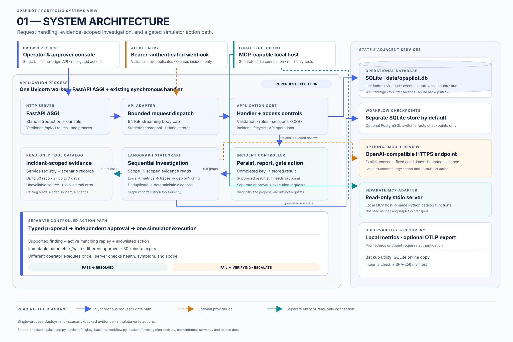
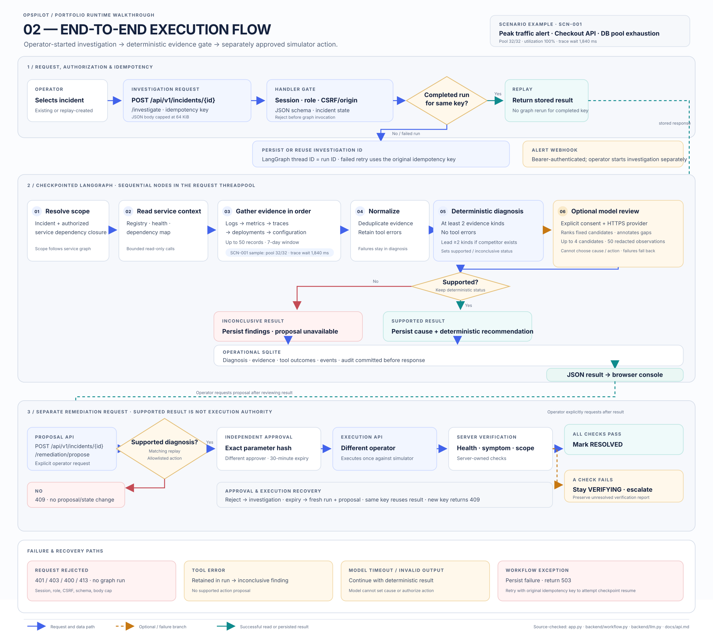

# OpsPilot

OpsPilot is a local incident investigation and controlled-remediation platform. It combines an auditable incident workspace, a checkpointed LangGraph investigation, bounded read-only MCP tools, an evidence-linked diagnosis engine, a two-person approval flow, and an isolated fault replay lab.

OpsPilot demonstrates a safety-gated incident workflow for SRE and backend teams. Operators inspect scoped evidence and deterministic diagnosis; remediation remains a separate simulator-only action that requires independent approval and server-side verification.

## Architecture

The browser UI and versioned API run in one FastAPI/Uvicorn process. SQLite stores incidents and audit history; LangGraph checkpoints use SQLite by default, with PostgreSQL available for checkpoints. Investigation tools are read-only, and the optional model can only rank deterministic candidates after explicit consent.





The [diagram folder](docs/portfolio-diagrams/README.md) contains editable Mermaid sources and PNG exports.

## What works today

- Incident intake from the console, versioned API, or an authenticated alert webhook; manual and webhook intake can include scoped evidence.
- Incident lifecycle, comments, evidence, investigation history, audit timeline, and JSON report export.
- Eight registered services and 36 deterministic cases, including missing, contradictory, multi-fault, and instruction-like evidence.
- A LangGraph workflow with a durable SQLite checkpointer; a PostgreSQL checkpointer can be configured independently.
- A read-only Prometheus HTTP adapter for operator-configured PromQL signals, bounded by service scope, a seven-day incident window, response size, and request timeout.
- Ten bounded, read-only MCP tools over scenario evidence or caller-submitted normalized observations.
- Optional, HTTPS-only OpenAI-compatible hypothesis ranking. It is disabled unless data transfer is explicitly enabled, and it cannot select an unsupported cause or execute an action.
- Immutable, typed remediation proposals for eligible seeded faults. A distinct approver must approve the exact parameters; a different operator executes the action against the simulator; server-side checks determine whether the incident can resolve.
- Request metrics, optional OTLP traces and metrics, and a verified SQLite backup utility.
- A checksum-verified restore command that only writes to a new data directory.
- A non-root container image with a database readiness healthcheck. CI builds the image on pull requests, and a version tag publishes it to GitHub Container Registry.
- A minimal responsive console for overview, incidents, service topology, investigation, approvals, and replay/evaluation.

## Technology stack

| Area | Technology |
| --- | --- |
| UI | Static HTML, CSS, and JavaScript |
| API and server | FastAPI, Uvicorn, and Starlette |
| Investigation | LangGraph with persistent SQLite checkpoints; optional PostgreSQL checkpoints |
| Operational storage | SQLite |
| Evidence adapters | Bounded read-only tools, optional Prometheus HTTP API, and a local stdio MCP server |
| Optional model review | OpenAI-compatible HTTPS endpoint; consent-gated candidate ranking |
| Observability | Prometheus client and optional OpenTelemetry OTLP exporter |

## Project layout

```text
app.py                  Incident, API, and persistence logic
backend/                ASGI adapter, investigation graph, evidence, and integrations
web/                    Console, introduction, and captioned demo video
tests/                  Unit and API integration tests with small fixtures
scripts/                Backup, evaluation, and loopback smoke utilities
docs/                   API, architecture, security, operations, and audit material
.github/workflows/      Python verification, container build, and tag release jobs
Dockerfile              Non-root container image
requirements.txt        Runtime dependencies
```

## Run locally

Requirements: Python 3.11–3.14 and Node.js 24 for the JavaScript syntax check. The API and console are served together.

~~~powershell
py -3.10 -m venv .venv
.\.venv\Scripts\Activate.ps1
python -m pip install --upgrade pip
python -m pip install -r requirements.txt
python app.py
~~~

Open http://127.0.0.1:8765 for the OpsPilot introduction. Choose **Get started** to open the authenticated console at http://127.0.0.1:8765/console. The console remains directly available at `/index.html` for existing bookmarks. On first start, the terminal prints separate one-time operator and approver passwords if they are not configured. Keep the terminal open until both values have been copied. These generated credentials change on the next process start; existing sessions expire after eight hours.

The introduction includes the local, captioned demo at `/demo.webm`.

For repeatable local credentials, set two different random values before starting. Keep them out of source control and logs.

~~~powershell
$env:OPSPILOT_PASSWORD = (python -c "import secrets; print(secrets.token_urlsafe(32))")
$env:OPSPILOT_APPROVER_PASSWORD = (python -c "import secrets; print(secrets.token_urlsafe(32))")
python app.py
~~~

By default, durable incident data is in data/opspilot.db and workflow checkpoints are in data/workflow-checkpoints.sqlite. Set OPSPILOT_DATA_DIR to move both local stores. The service listens on 127.0.0.1:8765 by default.

## Verify the main flow

1. Sign in as operator and start the database-pool replay.
2. Investigate; inspect the findings, evidence links, tool outcomes, and timeline.
3. Propose the allowlisted action. Sign in separately as approver, review the exact parameters, and approve or reject it with an audit note.
4. Sign in as a different operator, execute the approved action once, and confirm that server-recorded checks control resolution.
5. Run the 36 seeded rule checks. They verify the in-catalog signature rules, not independent incident accuracy.
6. Run `python -m scripts.evaluate` for 17 separately authored evidence-composition cases, including missing, unknown, conflicting, and unavailable-source evidence. This evaluates diagnosis after signal mapping; it does not measure raw telemetry classification or provider mapping quality.
7. Use the remaining replay cases to inspect missing-source, unavailable-tool, conflict, multi-fault, and untrusted-log behavior.

## Evaluation

The bundled catalog checks cover 28 labeled causes and 8 cases expected to remain inconclusive. The separately authored 17-case composition set has 13/13 expected supported decisions and 4/4 expected abstentions. These results measure rule consistency and cause selection after signal mapping; they do not establish classification accuracy on raw operational telemetry. See the [engineering audit](docs/engineering-audit.md) for scope and remaining verification work.

## Development checks

~~~powershell
python -m unittest discover -s tests
python -m compileall -q app.py backend scripts
node --check web\app.js
~~~

The test suite covers seeded rule consistency, held-out diagnosis/abstention, Prometheus response validation and intake wiring, normalized evidence scope, alert authentication and deduplication, login throttling, MCP boundaries, optional-LLM consent/redaction, independent approval, verification, idempotent execution, cold-start concurrent checkpoint recovery, schema migration, and backup/restore integrity. The GitHub Actions Python matrix runs these tests and static checks, then audits declared dependencies before a container build or release publish. Dependabot checks Python and GitHub Actions updates weekly. It is not a penetration, browser-automation, or hosted disaster-recovery certification.

With the local server running, `python -m scripts.smoke_load --requests 200 --concurrency 8` runs a loopback-only concurrent smoke against `/api/v1/health`. It reports latency and throughput for that endpoint; it is not a capacity test of investigations or external providers.

## Settings

| Variable | Purpose |
| --- | --- |
| OPSPILOT_DATA_DIR | Directory for the incident database and default LangGraph checkpoint database. |
| OPSPILOT_HOST / OPSPILOT_PORT | Listener address and port. Defaults to 127.0.0.1 / 8765. |
| OPSPILOT_PASSWORD / OPSPILOT_APPROVER_PASSWORD | Distinct operator and approver credentials, at least 16 characters each. If absent, random values are printed at startup. |
| OPSPILOT_ALERT_WEBHOOK_TOKEN | Optional bearer credential for alert intake; must be at least 32 characters. |
| OPSPILOT_CHECKPOINT_DATABASE_URL | Optional PostgreSQL URL for LangGraph checkpoints only. Incident and approval records remain in SQLite. |
| OPSPILOT_PROMETHEUS_URL | Optional Prometheus base URL. HTTPS is required except for loopback HTTP. |
| OPSPILOT_PROMETHEUS_QUERIES | JSON object mapping supported metric signal IDs to PromQL expressions. Configure expressions to return a series only when that signal's condition is met, and scope each expression to the service named by the signal. |
| OPSPILOT_PROMETHEUS_TOKEN | Optional bearer token for the Prometheus API. |
| OPSPILOT_ALLOW_REMOTE | Must equal `true` to bind beyond loopback; remote mode also requires configured credentials, an HTTPS public origin, and Secure cookies. |
| OPSPILOT_PUBLIC_ORIGIN | The HTTPS origin used by a remote deployment behind its TLS proxy. |
| OPSPILOT_COOKIE_SECURE | Must equal `true` when the configured public origin uses HTTPS. |
| OTEL_EXPORTER_OTLP_ENDPOINT | Optional OTLP HTTP endpoint for workflow API traces and metrics. |
| OPSPILOT_LLM_DATA_CONSENT | Must equal true before evidence observations can be sent to an external model provider. |
| OPSPILOT_LLM_API_KEY / OPSPILOT_LLM_MODEL / OPSPILOT_LLM_BASE_URL | Optional provider configuration. The base URL must use HTTPS. |

Alert intake is POST /api/v1/webhooks/alerts with an Authorization: Bearer header. Repeated correlation IDs are deduplicated; a reused ID with a different payload is rejected.

See the [engineering audit](docs/engineering-audit.md), [API contracts](docs/api.md), [architecture](docs/architecture.md), [security boundary](docs/security.md), and [operations runbook](docs/runbook.md).

## Deployment boundary

The Prometheus adapter reads configured metric signals. Logs, traces, and change events enter through authenticated normalized-evidence intake, and operators own the signal mappings. Incidents are stored in SQLite, access uses two shared local accounts, and approved changes affect simulator state. Shared deployment requires managed identity, hosted storage, and deployment-specific security testing; see the security and architecture docs.

The container requires explicit operator and approver passwords, remote-bind opt-in, an HTTPS public origin, and Secure cookies. Put it behind a trusted TLS reverse proxy, keep its published port loopback-only, and mount persistent storage at `/data`. Pushing a `vX.Y.Z` tag to the repository triggers the GHCR publish workflow.
